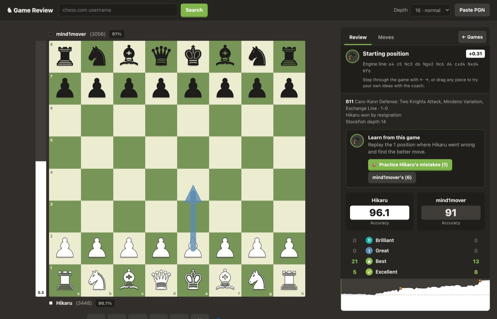
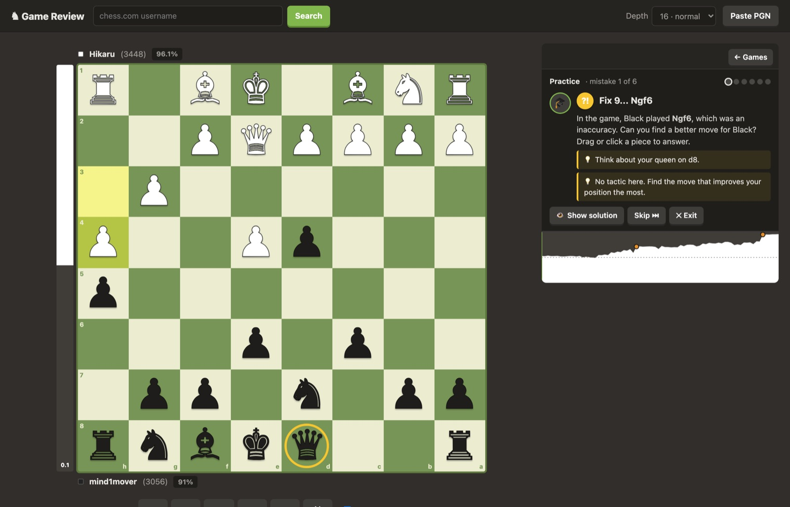
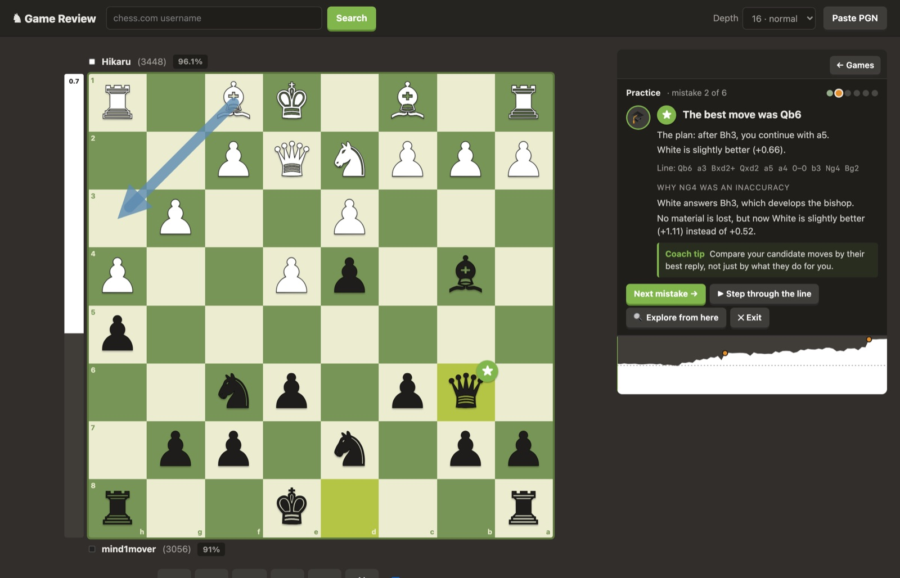
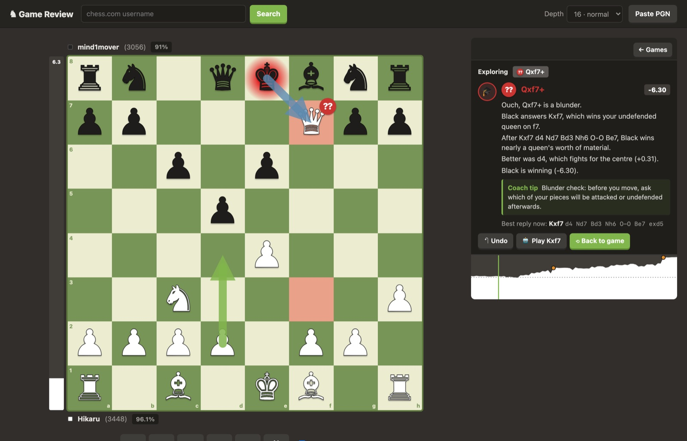
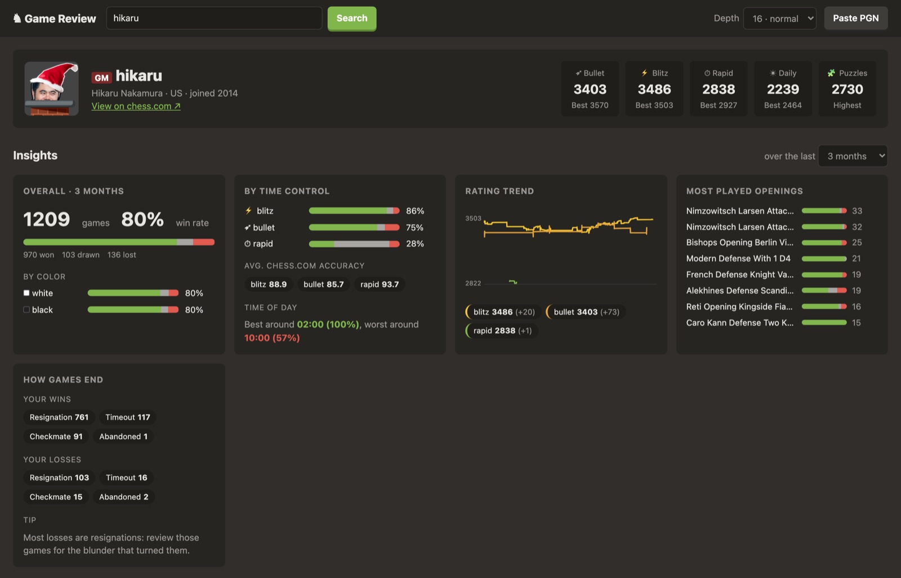

# ♞ Chess Game Review & Coach

A self-hosted, chess.com-style **game review** with a built-in **coach** that teaches you the better moves. Enter any chess.com username to browse games and get profile insights. Every move is analyzed with Stockfish, and the coach lets you replay your mistakes until you find the right move.

Everything runs in a single Docker container. No account or API key is needed.



## Features

### Game review
- **Every move labeled** like chess.com: Brilliant, Great, Best, Excellent, Good, Book, Inaccuracy, Mistake, Miss or Blunder. Labels appear on the board and in the move list.
- **Coach explanations** based on concrete tactics, not just numbers:
  - "*Black answers Nxe4, which forks your king and rook.*"
  - "*Your queen on h4 was already under attack and is still unprotected.*"
  - "*Better was Qg3, which attacks their rook on h4 and wins a pawn after…*"
  - "*It activates your queen, which now controls 18 squares instead of 12.*"
- **Coach tips** that turn each mistake into a habit to practice ("Blunder check: before you move…").
- **Accuracy** for each player, overall and per phase (opening, middlegame, endgame), plus key moments.
- **Eval bar, clickable eval graph, best-move arrows**, opening names from the lichess opening database, clocks and time spent per move.
- **Shareable links**: every review has a URL (`#/review/<id>?ply=34`).

### Coach: learn from your mistakes

| Fix your mistake | Get the solution explained |
|---|---|
|  |  |

- **Retry any mistake**: the board goes back to the position before the error. You play a better move (drag or click) and the coach grades it.
- **Hints, step by step**: first which piece to look at, then the idea ("look for a fork", "your opponent threatens mate"), then the full solution.
- **Practice mode** goes through all your mistakes in a game and scores you at the end: solved first try, solved with help, or revealed.
- **Wrong answers are explained**: the coach shows the opponent's refutation with a red arrow, without giving away the solution.

### Explore with the coach


- Drag any piece in any position to try your own idea. The coach evaluates it against the best move and tells you why.
- Ask the engine to reply, undo moves, or step through the best line move by move.

### Share a PDF with a friend
Click **⤴ Share** in a review to create a PDF ([see a sample](docs/sample-review.pdf)):
- a summary with accuracy, move labels, the final position, a short story of the game and the eval graph
- **puzzles from the game**: positions where someone went wrong, for your friend to solve, with solutions at the end
- **key moments**: board diagrams with arrows for the move played and the best move, plus the coach's explanations and tips
- the full move list, and optionally your name, a personal note and a link to the interactive review

You can **download** the PDF, or send it straight from your system's share sheet (Mail, Messages, WhatsApp…) where the browser supports sharing files.

### Profile insights


Ratings, win rate by color and time control, rating trend, your most-played openings with results, how your games end, and your best and worst time of day to play.

## Quick start

```bash
git clone https://github.com/nicolocandiani/chess_analyzer.git
cd chess_analyzer
docker compose up -d --build
```

Open **http://localhost:8000** and search for a chess.com username.

You can also click **Paste PGN** to review any game, not only chess.com ones.

### Configuration

Copy `.env.example` to `.env` to change the defaults:

| Variable | Default | Purpose |
|---|---|---|
| `PORT` | 8000 | Host port |
| `ENGINE_THREADS` | 2 | Stockfish threads per analysis |
| `ENGINE_HASH_MB` | 128 | Stockfish hash size |
| `ANALYSIS_WORKERS` | 2 | Games analyzed in parallel |
| `DEFAULT_DEPTH` | 16 | Review depth when the client doesn't send one |
| `COACH_DEPTH` | 16 | Depth used to grade moves you try with the coach |

Analysis takes about 1 second per position at depth 16 with 2 threads. Pick **depth 12** in the header for quick reviews, or raise `ENGINE_THREADS` if you have spare cores. Finished reviews are cached in the `analysis-cache` volume, so reopening a game is instant.

### Running without Docker

You need Python 3.10+ and Stockfish installed (`brew install stockfish` or `apt install stockfish`).

```bash
python -m venv .venv && source .venv/bin/activate
pip install -r requirements.txt
python app/build_openings.py app/openings.json   # optional: opening book
uvicorn app.main:app --reload
```

## How it works

```
chess.com public API ──► FastAPI backend ──► Stockfish (python-chess)
                              │
                              ├─ analysis.py  evaluations, move labels, accuracy
                              ├─ coach.py     tactics detection, explanations, hints, live grading
                              ├─ pdf_report.py  shareable PDF (diagrams, key moments, puzzles)
                              └─ chesscom.py  profiles, game archives, insights
                              ▼
                     static/ (vanilla JS, no build step)
```

**Move labels.** Each Stockfish eval is converted to a win probability for the side to move. A move is judged by how much win probability it loses compared with the engine's best move:

| Win probability lost | Label |
|---|---|
| 0 (engine move) | Best |
| < 2% | Excellent |
| < 5% | Good |
| < 10% | Inaccuracy |
| < 20% | Mistake |
| ≥ 20% | Blunder |

- **Brilliant**: a (near-)best move that gives up material the opponent can actually keep, while the position stays good.
- **Great**: the only good move, where the second-best move is at least 15% worse.
- **Miss**: failing to punish the opponent's previous error.
- **Book**: positions found in the [lichess chess-openings](https://github.com/lichess-org/chess-openings) dataset.
- **Accuracy** uses the lichess formula. chess.com's own formula isn't public, so numbers can differ by a few points.

**Explanations.** The coach replays the engine lines and detects concrete motifs: hanging pieces, forks, pins, discovered attacks, mate threats, threats you overlooked, and material won or lost along a line (counted at quiet positions, so normal trades aren't reported as losses). For quiet moves it describes piece activity, open files, space, king activity and the follow-up plan.

## API

| Endpoint | Description |
|---|---|
| `GET /api/player/{user}` | Profile and ratings |
| `GET /api/player/{user}/archives` | Months with games |
| `GET /api/player/{user}/games/{year}/{month}` | Games of a month |
| `GET /api/player/{user}/insights?months=3` | Aggregated statistics |
| `POST /api/analyze` `{pgn, depth}` | Start a review job; returns `job_id` and `key` |
| `GET /api/jobs/{job_id}` | Job progress and result |
| `GET /api/analysis/{key}` | A finished review |
| `POST /api/analysis/{key}/pdf` `{perspective, sender, note, link, puzzles, moves}` | Shareable PDF of a review |
| `POST /api/coach/position` `{fen}` | Legal moves, best move, hints |
| `POST /api/coach/move` `{fen, uci}` | Grade and explain a move |
| `POST /api/coach/line` `{fen, moves}` | Positions along a line of moves |

## Credits

- [Stockfish](https://stockfishchess.org/), the chess engine (GPLv3; installed from Debian packages, not bundled in this repo)
- [python-chess](https://github.com/niklasf/python-chess) and [ReportLab](https://www.reportlab.com/) for the PDFs
- [DejaVu fonts](https://dejavu-fonts.github.io/) for the chess diagrams
- [lichess chess-openings](https://github.com/lichess-org/chess-openings) (CC0)
- Game data from the [chess.com Published-Data API](https://www.chess.com/news/view/published-data-api)

This project is not affiliated with chess.com.

## License

[MIT](LICENSE)
